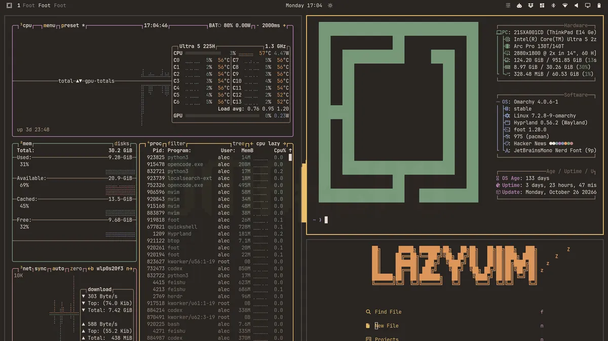

# Melange Dark for Omarchy

A warm, low-contrast Omarchy theme based on [savq/melange-nvim](https://github.com/savq/melange-nvim), with earthy surfaces and a golden accent.



## Palette

| Role | Color |
| --- | --- |
| Background | `#292522` |
| Deeper / deepest surface | `#231F1D` / `#1C1917` |
| Raised surface | `#34302C` |
| Foreground | `#ECE1D7` |
| Accent | `#EBC06D` |

Normal and bright colors follow Melange's upstream palettes. Deeper surfaces are derived for Omarchy. The wallpaper retains the centered pixel lettering of Omarchy's bundled wallpaper, recolored with this theme's background and accent.

## Install

For recent Omarchy releases that generate application configurations from `colors.toml`:

```sh
omarchy theme install https://github.com/xvvhang/omarchy-melange-dark-theme
```

Switch later through the theme menu or run:

```sh
omarchy theme set melange-dark
```

**Back up an existing theme first:** installation may replace `~/.config/omarchy/themes/melange-dark/`.

To preserve your current wallpaper when switching:

```sh
OMARCHY_THEME_SKIP_BACKGROUND=1 omarchy theme set melange-dark
```

## Attribution

Palette based on [savq/melange-nvim](https://github.com/savq/melange-nvim). Wallpaper adapted from the Omarchy-bundled Gruvbox `backgrounds/omarchy.png`; no font software is bundled. This is an independent theme, not an official Melange or Omarchy release.

By [Alec Xu / @xvvhang](https://github.com/xvvhang). Companion theme: [Melange Light](https://github.com/xvvhang/omarchy-melange-light-theme).
